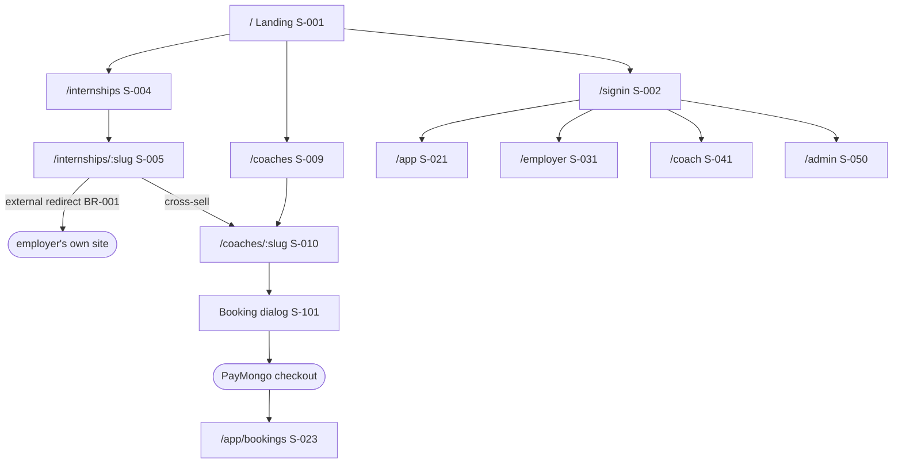

# Sitemap — screens, IA, routes, access

**Project:** iSkolar Vocation
**Maintained by:** Alexandre Nevero (PM)
**Last updated:** 2026-09-08
**Status:** Draft
**FMD version:** 4.6.2

> **Purpose:** the **static half of ux-maps**. What exists, where it lives, who can reach it.
> Movement between screens belongs in [User Flow](user-flow.md).
> Traces back to: [PRD](prd.md) (`F-###`). Traces forward to: user-flow, api-spec,
> security-compliance *(not yet selected)*.
>
> **If a screen is not in §2, it does not exist for the build.** `S-###` IDs are permanent.
>
> **v1 is 17 features.** Screens serving the eight deferred features
> ([ADR-0010](adr/ADR-0010-mvp-cut-to-17-features.md)) are marked **Deferred** in place, not
> removed, so reviving one is a status flip. A Deferred screen has no route and no build task.

## 1. Navigation model

**Primary pattern:** mobile-first. A top bar on every screen carrying the two pillars
(Internships, Coaching) plus an auth-aware account control. Below 768px the pillar links collapse
into a hamburger sheet and filters become a bottom drawer; from 768px up, filters are a persistent
left sidebar.

**Why this pattern:** the charter §I specifies mobile-first, and F-002's acceptance criteria
explicitly require "a sidebar on desktop and a bottom drawer on mobile". Two pillars is too few to
justify a tab bar and too important to bury.

**Top-level destinations:**

| Destination | Label shown | Screen | Route | Auth | Serves |
|-------------|-------------|--------|-------|------|--------|
| Landing | iSkolar Vocation | S-001 | `/` | Public | F-001 |
| Internships | Internships | S-004 | `/internships` | Public | F-002 |
| Companies | Companies | S-006 | `/companies` | Public | F-006 |
| Coaching | Coaching | S-008 | `/coaching` | Public | F-010 |
| Coaches | Find a Coach | S-009 | `/coaches` | Public | F-010 |
| ~~Programs~~ | — | S-011 | — | — | **Deferred** with F-012 (ADR-0010) |
| Account area | *(avatar menu)* | S-021 / S-031 / S-041 | role-dependent | Session | F-021, F-031, F-041 |

**Persistent elements:** top bar on every screen; auth state drives it (logged-out shows Sign in /
Get Started, logged-in shows the avatar menu) per F-020's acceptance criteria.

**Back / exit behavior:** browser back always works. Saving from a directory card must not
navigate (F-005), so the directory keeps filter and scroll state across back-navigation from a
detail screen. No destructive action is reachable by back after commit — in particular, back from
a PayMongo redirect never re-submits a booking.

## 2. Screen inventory

### Public

| ID | Screen | Purpose (one line) | Serves | Entry points | Auth | Required states |
|----|--------|--------------------|--------|--------------|------|-----------------|
| S-001 | Landing | Present both pillars, featured items, Get Started | F-001 | direct URL, search | Public | loading / loaded / error (featured data is live, so it can fail) |
| S-002 | Sign in | Authenticate any of the three roles | F-020, F-030, F-040 | nav, redirect with `next` | Public | idle / submitting / error |
| S-003 | Sign up | Register, choosing student / employer / coach | F-020, F-030, F-040 | nav, S-001 CTA | Public | idle / submitting / error |
| S-004 | Internship directory | Search, filter and sort internship and OJT roles | F-002 | nav, deep link with query | Public | empty / loading (skeletons) / error / results |
| S-005 | Internship detail | Evaluate a role and act on it | F-003 | S-004, shared link | Public | loading / loaded / not-found / closed-or-withdrawn |
| S-006 | Companies directory | Browse employers, searchable | F-006 | nav | Public | empty / loading / error / results |
| S-007 | Company profile | Company detail and its open roles | F-006 | S-006, S-005 company link | Public | loading / loaded / not-found |
| S-008 | Coaching hub | Explain coaching, surface top-rated coaches | F-010 | nav, S-005 cross-sell | Public | loading / loaded / error |
| S-009 | Coach directory | Search and filter coaches by expertise and price | F-010 | nav, S-008 | Public | empty / loading / error / results |
| S-010 | Coach profile | Coach detail, reviews, and the Book action | F-011, F-013 | S-009, S-008, S-005 cross-sell | Public | loading / loaded / not-found |
| S-011 | ~~Programs list~~ | **Deferred** with F-012 (ADR-0010) | F-012 | — | — | — |
| S-012 | ~~Program detail~~ | **Deferred** with F-012 (ADR-0010) | F-012 | — | — | — |
| S-013 | Password reset | Request and complete a reset | F-020, F-040 | S-002 link, email link | Public | idle / submitting / sent / invalid-token / error |
| S-014 | Terms of Service | Static legal content | — | footer, PayMongo onboarding | Public | static |
| S-015 | Privacy Policy | Static legal content. **Required by Google OAuth and RA 10173** | — | footer, OAuth consent screen | Public | static |
| S-016 | Refund Policy | Static legal content. **Required by PayMongo activation** | — | footer, checkout | Public | static |
| S-017 | Contact | How to reach iSkolar. **Required by PayMongo activation** | — | footer | Public | static |

### Student (session)

| ID | Screen | Purpose | Serves | Entry points | Auth | Required states |
|----|--------|---------|--------|--------------|------|-----------------|
| S-020 | Student onboarding | Capture school, course, year level, skills | F-020 | post-signup | Session (student) | step / submitting / error |
| S-021 | Student dashboard | Counts and profile-completeness meter | F-021 | post-auth, avatar menu | Session (student) | empty / loading / error / loaded |
| S-022 | Saved internships | The saved shortlist | F-005, F-021 | S-021 | Session (student) | empty / loading / error / results |
| S-023 | Bookings | Upcoming vs past; join, or complete payment | F-022, F-013 | S-021, post-checkout return | Session (student) | empty / loading / error / loaded |
| S-024 | Student profile edit | Name, school, course, year, skills, bio, avatar, resume | F-023 | S-021 | Owner | idle / submitting / error / saved |
| S-025 | Student settings | Email, password, notification preferences, logout | F-023 | S-021 | Owner | idle / submitting / error / saved |

### Employer (session) — **all Deferred (ADR-0010)**

Admin enters listings at launch via S-051. Rows kept for revival.

| ID | Screen | Purpose | Serves | Entry points | Auth | Required states |
|----|--------|---------|--------|--------------|------|-----------------|
| S-030 | ~~Employer onboarding~~ | **Deferred** (ADR-0010) | — | — | — | — |
| S-031 | ~~Employer dashboard~~ | **Deferred** (ADR-0010) | — | — | — | — |
| S-032 | ~~Company profile edit~~ | **Deferred** (ADR-0010) | — | — | — | — |
| S-033 | ~~My listings~~ | **Deferred** (ADR-0010) | — | — | — | — |
| S-034 | ~~Posting composer~~ | **Deferred** (ADR-0010) | — | — | — | — |

### Coach (session)

| ID | Screen | Purpose | Serves | Entry points | Auth | Required states |
|----|--------|---------|--------|--------------|------|-----------------|
| S-040 | Coach onboarding | Bio, expertise, session types, pricing | F-040 | post-signup | Session (coach) | step / submitting / error |
| S-041 | Coach dashboard | Sessions and account at a glance | F-041 | post-auth | Session (coach) | empty / loading / error / loaded |
| S-042 | Coach profile edit | Profile, free/paid pricing and rate | F-041 | S-041 | Owner | idle / submitting / error / saved |
| S-043 | Availability | Manage bookable slots | F-041 | S-041 | Owner | empty / editing / submitting / error |
| S-044 | Coach sessions | Upcoming and past bookings | F-041 | S-041 | Owner | empty / loading / error / loaded |
| S-045 | ~~Coach verification~~ | **Deferred** with F-043 (ADR-0010) — removes all government-ID handling from v1 | — | — | — | — |
| S-046 | Coach earnings | Per-booking payout and commission | F-042 | S-041 | Owner | empty / loading / error / loaded |

### Admin (elevated)

| ID | Screen | Purpose | Serves | Entry points | Auth | Required states |
|----|--------|---------|--------|--------------|------|-----------------|
| S-050 | Admin dashboard | Queue counts | F-050, F-051, F-052 | post-auth | Elevated | loading / loaded / error |
| S-051 | **Admin listing management** | Create, edit, publish and withdraw listings directly | F-050 | S-050 | Elevated | empty / loading / error / results / saving |
| S-052 | ~~Coach verification queue~~ | **Deferred** with F-051 (ADR-0010) | — | — | — | — |
| S-053 | ~~Company verification queue~~ | **Deferred** with F-052 (ADR-0010) | — | — | — | — |

### System screens

| ID | Screen | When it shows | Required? |
|----|--------|---------------|-----------|
| S-090 | Not found (404) | Route does not resolve; withdrawn posting; unverified deep link | Yes |
| S-091 | Error (500) | Unhandled failure | Yes |
| S-092 | Access denied (403) | Authenticated but wrong role | Yes — four roles exist |
| S-093 | Offline / connection lost | Network fails | **Yes — the product is mobile-first (charter §I)** |
| S-094 | Maintenance | Planned downtime | Optional |

### Modals / sheets / overlays

| ID | Overlay | Opens from | Purpose | Dismissible? |
|----|---------|------------|---------|--------------|
| S-101 | Booking dialog | S-010 | Session type, day, time slot, optional notes | Yes |
| S-102 | Rate this session | S-023 | 1–5 stars plus optional review | Yes — explicitly dismissible (BR-010) |
| S-103 | Leaving-the-site notice | S-005 | Signal the student is departing for the company's own site (F-004) | Yes |
| S-104 | Filter drawer | S-004, S-009 | Bottom-drawer filters below 768px | Yes |
| S-105 | ~~Verification upload~~ | **Deferred** with F-043 (ADR-0010) | — | — |
| S-106 | Share confirmation | S-005 | Confirm the link was copied | Auto-dismiss |
| S-107 | Withdraw listing confirm | S-051 | Confirm immediate removal from public view (BR-006) | Yes (blocking until answered) |

## 3. Information architecture

```
/                              (public)   S-001  Landing
├── /signin                    (public)   S-002
├── /signup                    (public)   S-003
├── /reset                     (public)   S-013
├── /internships               (public)   S-004  Directory
│   └── /internships/:slug     (public)   S-005  Detail
├── /companies                 (public)   S-006
│   └── /companies/:slug       (public)   S-007
├── /coaching                  (public)   S-008  Hub
├── /coaches                   (public)   S-009  Directory
│   └── /coaches/:slug         (public)   S-010  Profile
├── /terms                     (public)   S-014
├── /privacy                   (public)   S-015
├── /refunds                   (public)   S-016
├── /contact                   (public)   S-017
├── /programs                  DEFERRED   S-011  (F-012)
│   └── /programs/:slug        DEFERRED   S-012
├── /app                       (student)
│   ├── /app/onboarding                   S-020
│   ├── /app                              S-021  Dashboard
│   ├── /app/saved                        S-022
│   ├── /app/bookings                     S-023
│   ├── /app/profile                      S-024
│   └── /app/settings                     S-025
├── /employer                  DEFERRED  (F-030..F-033, ADR-0010)
│   └── (S-030..S-034)
├── /coach                     (coach)
│   ├── /coach/onboarding                 S-040
│   ├── /coach                            S-041  Dashboard
│   ├── /coach/profile                    S-042
│   ├── /coach/availability               S-043
│   ├── /coach/sessions                   S-044
│   ├── /coach/verification               S-045  DEFERRED (F-043)
│   └── /coach/earnings                   S-046
└── /admin                     (elevated)
    ├── /admin                            S-050
    ├── /admin/listings                   S-051  Listing management
    ├── /admin/coaches                    S-052  DEFERRED (F-051)
    └── /admin/companies                  S-053  DEFERRED (F-052)
```



**Depth rule:** nothing a student needs daily is more than two taps from their dashboard. The
booking path — the revenue path — is three taps from the landing page: Coaching → coach → Book.

**Orphans:** every §2 screen appears in the tree above. Intentionally unlinked: S-053 (pending
PRD Q1), S-094 (operational only).

## 4. Route table

| Route | Screen | Params | Auth | Method(s) | Indexable | Notes |
|-------|--------|--------|------|-----------|-----------|-------|
| `/` | S-001 | — | Public | GET | **Yes** | Primary marketing surface |
| `/signin` | S-002 | `?next=` | Public | GET | No | Redirects to role home if a session exists |
| `/signup` | S-003 | `?role=` | Public | GET | No | |
| `/reset` | S-013 | `?token=` | Public | GET | No | Invalid or expired token → S-013 error state, never S-090 |
| `/terms` · `/privacy` · `/refunds` · `/contact` | S-014–S-017 | — | Public | GET | **Yes** | Static. Gate PayMongo activation and the Google OAuth consent screen |
| `/internships` | S-004 | `?q&field&setup&pay&duration&sort&page` | Public | GET | **Yes** | Filters live in the URL so a filtered view is shareable |
| `/internships/:slug` | S-005 | `slug` | Public | GET | **Yes** | Non-`open` posting → S-090, never a preview (BR-003) |
| `/companies` | S-006 | `?q&page` | Public | GET | **Yes** | |
| `/companies/:slug` | S-007 | `slug` | Public | GET | **Yes** | |
| `/coaching` | S-008 | — | Public | GET | **Yes** | |
| `/coaches` | S-009 | `?q&expertise&price&page` | Public | GET | **Yes** | |
| `/coaches/:slug` | S-010 | `slug` | Public | GET | **Yes** | Reviews are public with reviewer first name only (BR-011) |
| ~~`/programs`~~ | S-011 | — | — | — | — | **Deferred** with F-012 |
| ~~`/programs/:slug`~~ | S-012 | — | — | — | — | **Deferred** with F-012 |
| `/app/*` | S-020–S-025 | — | Session (student) | GET | No | |
| ~~`/employer/*`~~ | S-030–S-034 | — | — | — | — | **Deferred** (ADR-0010). No employer routes exist in v1 |
| `/coach/*` | S-040–S-046 | — | Session (coach) + owner | GET | No | |
| `/admin/*` | S-050, S-051 | — | Elevated | GET | No | S-052/S-053 deferred. `/admin/listings` is the v1 surface |

**Route conventions:** kebab-case, plural collections, human-readable slugs on public pages,
opaque ids on owner-scoped edit routes.

**Redirects:**

| From | To | When | Permanent? |
|------|----|------|------------|
| `/signin` | role home (S-021 / S-031 / S-041 / S-050) | session already exists | No |
| `/app/*`, `/employer/*`, `/coach/*`, `/admin/*` | `/signin?next=<path>` | no session | No |
| `/app` | `/app/onboarding` | student onboarding incomplete | No |
| ~~`/employer`~~ | — | **Deferred** (ADR-0010) | — |
| `/coach` | `/coach/onboarding` | no coach profile yet | No |
| PayMongo return URL | `/app/bookings` | after checkout, whatever the outcome | No |

**Crawler / discoverability:** allow all Public routes; `noindex` on `/app/*`, `/employer/*`,
`/coach/*`, `/admin/*`, `/signin`, `/signup`, `/reset`. Public routes are marketing surfaces, so
the SPA choice (charter §II) needs prerendering or SSR for them to be indexable at all — flagged
in [`system-design.md`](https://github.com/iskolar-web3/vocation-server/blob/main/docs/system-design.md) technology trade-offs.

## 5. Access boundaries

| Zone | Screens | Who gets in | Enforced where | On denial |
|------|---------|-------------|----------------|-----------|
| Public | S-001–S-013, S-090–S-094 | Anyone, no account | n/a | n/a |
| Session (student) | S-020–S-023 | Authenticated `student` | API middleware + route guard | Redirect to S-002 with `next` |
| ~~Session (employer)~~ | S-030–S-034 | **Deferred** (ADR-0010). No `employer` role surface in v1 | — | — |
| Session (coach) | S-040, S-041, S-044 | Authenticated `coach` | API middleware + route guard | Redirect to S-002 with `next` |
| Owner | S-024, S-025, S-032, S-034, S-042, S-043, S-045, S-046 | The record's owner only | Server query scoped by owner id | **S-090, not S-092** — never confirm that another party's record exists |
| Elevated | S-050, S-051 | `admin` | API middleware, checked per request | S-092 |

**Rule:** access is enforced on the server on every request. Hiding a nav item is UX, never
security. BR-003 is the concrete case: `status = 'open'` is a server-side query predicate, and a
client that asks for a `pending` posting gets S-090.

**Roles in v1:** `student`, `coach`, `admin`. The `employer` role exists in the schema but has no
surface until F-030 revives. Three active roles, so S-092 is still mandatory.

**Complex RBAC:** four roles with owner-scoping on eight screens is past the two-role threshold.
A dedicated authz section is **owed to `security-compliance`, which is not yet selected** — the
Security Engineer owns it. Not evaluated here beyond the table above.

## 6. Entry points from outside

| Source | Lands on | Signed out | Wrong account | Target gone |
|--------|----------|------------|---------------|-------------|
| Shared internship link | S-005 | Renders fully — no auth needed (BR-002) | n/a | S-090 (withdrawn or non-`open`) |
| Shared coach link | S-010 | Renders fully; Book prompts sign-in | n/a | S-090 |
| Password reset email | S-013 | Expected state | Token is user-bound → error state | Invalid-token state, not S-090 |
| Google OAuth callback | role home or S-020/S-030/S-040 | Expected state | Existing account with a different role → S-092 with an explanation | S-091 |
| **PayMongo return URL** | S-023 | Session expired mid-checkout → S-002 with `next=/app/bookings`; **the payment still completes via webhook** | n/a | Booking shows `pending` until the webhook lands |
| Coach verification decision email | S-045 | S-002 with `next` | S-092 | S-045 current-status state |

The PayMongo row is the one that matters: the browser returning is **not** what confirms a booking
(see [`system-design.md`](https://github.com/iskolar-web3/vocation-server/blob/main/docs/system-design.md) data flow). A student who closes the tab still gets a
confirmed booking once the webhook arrives.

## 7. Responsive / platform variants

Mobile-first per charter §I. Single form factor: responsive web. No native app.

| Screen | Mobile (<768px) | Desktop (≥768px) | Differences that matter |
|--------|-----------------|------------------|-------------------------|
| S-004, S-009 | Filters in a bottom drawer (S-104) | Filters in a persistent left sidebar | **Explicit in F-002's acceptance criteria** |
| S-001 | Pillars stack; value proposition above the fold | Pillars side by side | "Above the fold" is a mobile constraint first |
| S-005 | Apply and Save pinned in a sticky footer | Inline in the header block | The revenue-adjacent action must not require scrolling |
| S-023, S-033, S-044 | Cards | Table | Tables do not survive 375px |
| S-101 | Full-height sheet | Centred dialog | |

**Breakpoints:** 375 / 768 / 1280. **Primary design target:** mobile at 375px.

## 8. Not in the map

| Screen | Why not | Revisit when |
|--------|---------|--------------|
| Application tracker | BR-014 — no on-platform applications exist | Never, without reversing ADR-0006 |
| Employer applicant inbox / screening | BR-015 — explicitly excluded | Never, without reversing ADR-0006 |
| Scholarships, grants, full-time jobs | Charter §I puts them out of scope | Scope change + CR |
| HEI / university coordinator portal | No such role exists in the charter | Scope change |
| OJT hour log, MOA, certificate of completion | Vocation is not in the CHED compliance path | Scope change |
| Coach-to-student messaging | No story specifies it; sessions carry a join link instead | If session no-shows prove to need pre-session contact |
| Notification centre | F-023 stores preferences but no story defines delivery | PRD Q6 resolved |
| Session join / video surface | No provider chosen; `booking.join_url` is produced by nothing | [ADR-0012](adr/ADR-0012-session-delivery-model.md) decided |
| Booking cancellation screen | `booking_status` has `cancelled` and nothing sets it | [ADR-0012](adr/ADR-0012-session-delivery-model.md) decided |

## 9. Open questions

| # | Question | Blocks | Owner | Needed by |
|---|----------|--------|-------|-----------|
| Q1 | ~~S-053 company verification queue unspecified~~ **Moot for v1** — deferred (ADR-0010) | S-053 | PM | if revived |
| Q6 | **No screen exists for joining or cancelling a session.** `join_url` is produced by nothing and `cancelled` is set by nothing — [ADR-0012](adr/ADR-0012-session-delivery-model.md) blocks Wave 3 | S-023, S-101 | PM + Project Lead | **before Wave 3** |
| Q2 | Public routes are marketing surfaces on an SPA. Prerender, SSR, or accept poor indexability? | S-001, S-004, S-005, S-006, S-010 | Project Lead | before M2 |
| Q3 | Does a refund produce a student-visible state on S-023 and a coach-visible state on S-046? (PRD Q7) | S-023, S-046 | PM | before payments launch |
| Q4 | Can one account hold more than one role (a student who also coaches)? The OAuth wrong-account row assumes not. ERD Q1 | S-002, S-092, iam | Project Lead | before F-040 |
| Q5 | Is there a notification surface at all, or only email? (PRD Q6) | S-025 | PM | before F-023 |

## Self-check (advisory)

- [x] Every product `S-###` serves at least one `F-###`, or is a system screen
- [x] Important PRD features have at least one serving screen
- [x] Interactive screens declare empty / loading / error / success
- [x] 404 / 500 / 403 / offline exist — offline is required by mobile-first
- [x] Every §2 screen is in the §3 tree or listed as an intentional orphan
- [x] Every §4 route resolves to a §2 screen
- [x] Crawler policy stated
- [x] Non-public zones name **server-side** enforcement
- [x] External entry points define signed-out / wrong-account / gone behavior
- [x] No user journeys drawn here — those are in [`user-flow.md`](user-flow.md)
- [x] Listed in [`index.md`](index.md) §0 / §1
