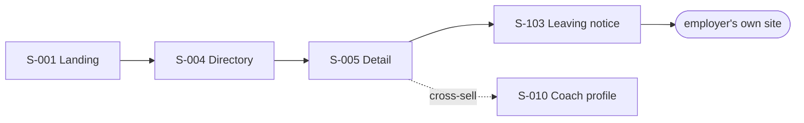

# User Flow — journeys across the sitemap

**Project:** iSkolar Vocation
**Maintained by:** Alexandre Nevero (PM)
**Last updated:** 2026-09-08
**Status:** Draft
**FMD version:** 4.6.2

> **Purpose:** the **dynamic half of ux-maps**. How a person moves from arrival to value, what
> branches, and how paths break. Screens belong in [Sitemap](sitemap.md).
> Traces back to: [PRD](prd.md), [Sitemap](sitemap.md). Traces forward to: qa-test-plan
> *(not yet selected)*, [System Design](https://github.com/iskolar-web3/vocation-server/blob/main/docs/system-design.md).
>
> **This is the charter's Milestone 1 "User Journey" deliverable.**
>
> **v1 is 17 features.** Flows serving the eight deferred features
> ([ADR-0010](adr/ADR-0010-mvp-cut-to-17-features.md)) are marked **Deferred** in place.
> Every step cites an existing `S-###`. No screen is defined here.

## 1. Flow inventory

| ID | Flow | Persona | Starts at | Ends at | Serves | Priority | Frequency |
|----|------|---------|-----------|---------|--------|----------|-----------|
| UF-001 | Orient and pick a pillar | Visitor | S-001 | S-004 or S-009 | F-001 | Must-Have | Once |
| UF-002 | Discover a role and apply out | Visitor/Student | S-004 | external site | F-002, F-003, F-004 | **Must-Have** | Weekly in season |
| UF-003 | Save a role for later | Student | S-004 / S-005 | S-022 | F-005, F-020 | Must-Have | Weekly |
| UF-004 | Book a free coach | Student | S-009 | S-023 | F-010, F-011 | Must-Have | Occasional |
| UF-005 | Book and pay for a coach | Student | S-009 | S-023 | F-011, F-042 | **Must-Have** | The revenue event |
| UF-006 | Review after a session | Student | S-023 | S-010 | F-013 | Must-Have | Per completed session |
| UF-007 | ~~Publish an internship posting (employer)~~ | — | — | — | F-030/032 | **Deferred** | ADR-0010 |
| UF-008 | ~~Edit, resubmit or withdraw a posting (employer)~~ | — | — | — | F-033 | **Deferred** | ADR-0010 |
| UF-009 | Onboard as a coach and open availability | Coach | S-003 | S-043 | F-040, F-041 | **Must-Have** | Once. Verification steps deferred with F-043 |
| UF-010 | Get paid for a session | Coach | S-044 | S-046 | F-042 | Must-Have | Per paid session |
| UF-011 | **Publish and manage listings** | Admin | S-050 | S-051 | F-050 | **Must-Have** | Daily. Replaces employer self-serve in v1 |
| UF-012 | ~~Enrol in a program~~ | — | — | — | F-012 | **Deferred** | ADR-0010 |

**Coverage:** every MVP `F-###` in the PRD appears in at least one flow, except F-006 (Companies —
a browsing surface reached from UF-002 without its own journey), F-021, F-023, F-031 (account
maintenance, not journeys), and F-052 (unspecified — PRD Q1).

## 2. Happy path (primary)

**UF-002 — Discover a role and apply out.** The core discovery value, and it needs no account.

1. Land on S-001 and choose Internships, or arrive at S-004 directly from search.
2. Filter on S-004 by field, work setup, compensation and duration; sort by deadline-soon.
3. Open a result → S-005. **Value moment:** requirements, perks, deadline and the apply action are
   all on one screen, for a role that actually matches the filters.
4. Press Apply → S-103 signals the departure → the employer's own page opens in a new tab.
5. The outbound click is recorded. Nothing else is stored (BR-001).

The dotted edge is the business model: the free path ends off-platform, and the cross-sell to
coaching is where revenue can begin (UF-005).

## 3. Alternate / secondary flows

| ID | When chosen | Differs from primary how |
|----|-------------|--------------------------|
| UF-003 | Student is not ready to apply | Ends on-platform at S-022 instead of leaving. **Requires an account**, so it is the first natural registration trigger |
| UF-004 | Coach is free, or offers an intro call | Skips PayMongo entirely; booking confirms immediately (BR-007) |
| ~~UF-012~~ | ~~Student wants multi-week preparation~~ | **Deferred** with F-012 (ADR-0010) |
| UF-001 → S-009 | Visitor arrives needing preparation, not a role | Enters the coaching pillar first; never touches the directory |

## 4. Flow detail

### UF-002 — Discover a role and apply out

| Step | Screen | User does | System does | Success looks like |
|------|--------|-----------|-------------|--------------------|
| 1 | S-004 | Types a keyword, sets filters | Queries `status='open'` only (BR-003); shows skeletons then results with a count | Result count matches the filters; URL carries the filter state |
| 2 | S-004 | Scrolls, opens a card | Preserves scroll and filter state for back-navigation | Back returns to the same filtered position |
| 3 | S-005 | Reads requirements and perks | Renders detail, related roles, cross-sold coaches | Deadline countdown is visible |
| 4 | S-005 | Presses Apply | Shows S-103, records the outbound click, opens `external_apply_url` in a new tab | Student understands they are leaving; the tab opens |
| 5 | — | Applies on the employer's site | **Nothing.** No application, resume or cover note is stored (BR-001) | Vocation's involvement ends |

**Branch points:** not signed in and presses Save → S-002 with `next` back to S-005 (→ UF-003).
Posting no longer `open` → S-090. Cross-sell tapped → S-010 (→ UF-005).

### UF-005 — Book and pay for a coach *(the revenue flow)*

| Step | Screen | User does | System does | Success looks like |
|------|--------|-----------|-------------|--------------------|
| 1 | S-009 | Filters coaches by expertise and price | Lists coaches with rating, review count and price | A bookable, ideally verified coach appears |
| 2 | S-010 | Reviews bio, session types, reviews | Renders profile; badge only if verified (BR-012) | Student can judge the coach |
| 3 | S-010 | Presses Book | Opens S-101 | Dialog shows session types and real availability |
| 4 | S-101 | Picks session type, day, slot, optional notes | Validates the slot against availability | Slot accepted, price shown |
| 5 | S-101 | Confirms | Writes booking `status=pending`, `payment_status=pending`; computes 5% platform fee and 95% `coach_payout` (BR-008); creates a PayMongo Payment Intent | Amount due is unambiguous before leaving |
| 6 | PayMongo | Pays by card, GCash, Maya or GrabPay | Handles 3DS or the e-wallet redirect | Provider reports success |
| 7 | S-023 | Returns | **Shows `pending` until the webhook lands** — the browser's return is not proof of payment | Honest state, not an optimistic lie |
| 8 | — | — | `payment.paid` webhook verified and applied: `payment_status → paid`, `status → confirmed` (BR-009) | Booking flips to confirmed with a join link |

**Branch points:** free coach or intro call → UF-004, skipping steps 5–8 (BR-007). Payment fails
→ `payment.failed`, booking stays `pending` and S-023 offers Complete payment (F-022). Student
abandons at the provider → booking stays `pending` until the intent expires (EV-005).

### UF-007 — Publish an internship posting — **DEFERRED (ADR-0010)**

*Kept for revival. In v1, listings are published by admin via UF-011.*

| Step | Screen | User does | System does | Success looks like |
|------|--------|-----------|-------------|--------------------|
| 1 | S-003 | Signs up as an employer | Creates the account, routes to onboarding | Lands on S-030 |
| 2 | S-030 | Enters company name, industry, location | Creates the company profile, unverified — **no badge** (BR-012) | Company exists and is publicly listable |
| 3 | S-034 | Composes a posting incl. the external apply URL | Validates, writes `status=pending`; **not public** (BR-004) | A clear notice explains moderation |
| 4 | S-051 | *(Admin)* reviews the queue | Approve → `open`; reject → `rejected` | Only `open` becomes public, server-enforced (BR-003) |
| 5 | S-033 | Sees the outcome | Lists own postings by status | Approved posting is live at S-005 |

**Branch points:** rejected → the employer can edit and resubmit (UF-008). Editing an `open`
posting → back to `pending`, removed from public view, flagged in the queue as a resubmission
(BR-005).

### UF-009 — Onboard as a coach and open availability

| Step | Screen | User does | System does | Success looks like |
|------|--------|-----------|-------------|--------------------|
| 1 | S-003 → S-040 | Signs up, enters bio, expertise, session types, pricing | Creates the coach profile | Coach is discoverable at S-009 |
| 2 | S-043 | Sets availability | Stores bookable slots | Book on S-010 offers real slots |
| ~~3~~ | ~~S-045~~ | ~~Uploads ID / certificates / proof~~ | **Deferred** with F-043 (ADR-0010) — no government IDs are held in v1 | — |
| ~~4~~ | ~~S-052~~ | ~~Admin reviews documents~~ | **Deferred** with F-051 (ADR-0010) | — |

**Branch points:** none in v1. Every coach is bookable, and no badge exists — verification left v1
with F-043 (ADR-0010), which also removes Q4's concern for now.

## 5. Edge cases and breaks

| ID | Flow | Break | User sees | Recovery | Work lost? |
|----|------|-------|-----------|----------|------------|
| EV-001 | UF-002 | Posting withdrawn while being viewed | S-090 on Apply | Back to S-004 | No |
| EV-002 | UF-002 | Employer's `external_apply_url` is dead | Someone else's 404, in a new tab | None — Vocation cannot detect it today | No, but trust is lost |
| EV-003 | UF-003 | Not signed in when saving | S-002 with `next` | Returns to S-005 and the save completes | No |
| EV-004 | UF-005 | **Webhook never arrives** | Booking stuck `pending` after successful payment | Reconciliation job polls intent status | **No, but the coach is uncredited until it runs.** Highest-severity case |
| EV-005 | UF-005 | Student abandons at the e-wallet redirect | Booking `pending`, slot held | Intent expiry releases the slot | No |
| EV-006 | UF-005 | Duplicate `payment.paid` delivery | Nothing | Idempotency on the intent id | No — **without it, double payout credit** |
| EV-007 | UF-005 | Session expires mid-checkout | S-002 with `next=/app/bookings` | **Payment still completes via webhook** | No |
| EV-008 | UF-005 | Slot taken between dialog open and confirm | Slot-unavailable error in S-101 | Pick another slot | No |
| EV-009 | UF-005 | Network drops between confirm and redirect | Booking may exist as `pending` with no intent | S-023 offers Complete payment | No |
| EV-010 | UF-010 | Chargeback after the coach was paid | `payment_status → refunded` | **Undefined — platform is out of pocket.** PRD Q7, Q10 | Money |
| EV-011 | UF-006 | Review submitted twice | Second attempt refused | One review per completed booking (BR-010) | No |
| EV-012 | UF-006 | Booking never marked `completed` | Rate prompt never appears | **Undefined — nothing says who sets `completed`.** PRD Q9, [ADR-0012](adr/ADR-0012-session-delivery-model.md) | Review lost |
| EV-018 | UF-004/005 | **Session cannot be joined** — `booking.join_url` is produced by nothing | A confirmed booking with no way to attend | **Undefined.** [ADR-0012](adr/ADR-0012-session-delivery-model.md) blocks Wave 3 | Money, if paid |
| EV-019 | UF-004/005 | **Session cannot be cancelled** — `booking_status` has `cancelled` and no endpoint sets it | No cancel action anywhere | **Undefined.** [ADR-0012](adr/ADR-0012-session-delivery-model.md) blocks Wave 3 | Money, if paid |
| EV-013 | UF-007 | Session expires mid-compose | S-002 with `next` | **Draft is lost unless the composer persists locally** | **Yes, unless designed for** |
| EV-014 | UF-008 | Employer withdraws while a student views it | S-090 | Back to S-004 | No |
| EV-015 | UF-009 | Verification document upload fails | Upload error in S-105 | Retry; status stays Not Verified | No |
| EV-016 | any | Offline on mobile | S-093 | Retry on reconnect | Depends on the screen — mobile-first makes this common |
| EV-017 | any | Wrong role for the route | S-092; owner-scoped records give S-090 instead | Sign in as the right role | No |

EV-004, EV-006 and EV-010 are the three that cost money rather than convenience. They belong in
the QA plan as required cases the moment one is selected.

## 6. Instrumentation (before launch)

| Event | Fires when | Properties | Used for |
|-------|------------|------------|----------|
| `internship_search` | S-004 query returns | filter set, result count, sort | Is the filter set the right one? Feeds PRD Q5 |
| `internship_view` | S-005 loads | posting id, source (directory / share / cross-sell) | Discovery funnel |
| `apply_click_out` | Apply pressed on S-005 | posting id, company id | **The only apply signal that exists** (BR-001) |
| `internship_save` | F-005 toggled | posting id, surface (card / detail) | Registration trigger strength |
| `coach_view` | S-010 loads | coach id, source — cross-sell or directory | Does the internship → coaching cross-sell work? |
| `booking_created` | Booking written | booking id, paid or free, price | Activation (`VOCATION.md` §B8) |
| `booking_confirmed` | Webhook applied | booking id, method, latency from creation | Payment reliability, EV-004 detection |
| `booking_payment_failed` | `payment.failed` | booking id, method | Checkout drop-off by method |
| `review_submitted` | F-013 submitted | booking id, rating | Coach quality signal |
| `posting_submitted` / `posting_moderated` | F-032 / F-050 | posting id, decision, resubmission flag | Moderation throughput |

No property carries PII. `apply_click_out` is the deepest funnel event Vocation can ever observe —
by design, it cannot know whether the student was hired.

## 7. Open questions

| # | Question | Blocks | Owner | Needed by |
|---|----------|--------|-------|-----------|
| Q1 | Who or what marks a booking `completed`? Coach, student, admin, or a scheduled job after the slot passes? EV-012 and BR-010 both hang on it | UF-006, UF-010 | PM | before F-013 |
| Q2 | Does UF-005 hold the slot during checkout? If yes, for how long before EV-005 releases it? | UF-005 | Project Lead | before F-011 |
| Q3 | Does the composer (S-034) persist drafts locally to survive EV-013? | UF-007 | Project Lead | before F-032 |
| Q4 | ~~Should unverified coaches be bookable?~~ **Moot for v1** — verification deferred (ADR-0010), so every coach is bookable and no badge exists | UF-005, UF-009 | PM | if F-043 revives |
| Q5 | Refund flow: who initiates, on what policy, and what do S-023 and S-046 show? (PRD Q7) | UF-010, EV-010 | PM | before payments launch |
| Q6 | Can Vocation detect a dead `external_apply_url` (EV-002)? A link checker is unspecified. **Now iSkolar's own duty**, since admin enters the listings (ADR-0010) | UF-002 | Project Lead | before scale |
| Q7 | **How is a session joined, and how is it cancelled?** EV-018 and EV-019 have no answer. [ADR-0012](adr/ADR-0012-session-delivery-model.md) | UF-004, UF-005, UF-006 | PM + Project Lead | **before Wave 3** |

## Self-check (advisory)

- [x] Every step cites an existing `S-###`
- [x] Must-have flows have §4 detail; all flows have §5 breaks
- [x] No screen definitions duplicated from the sitemap
- [x] Money-losing edge cases named explicitly (EV-004, EV-006, EV-010)
- [x] Listed in [`index.md`](index.md) §0 / §1
